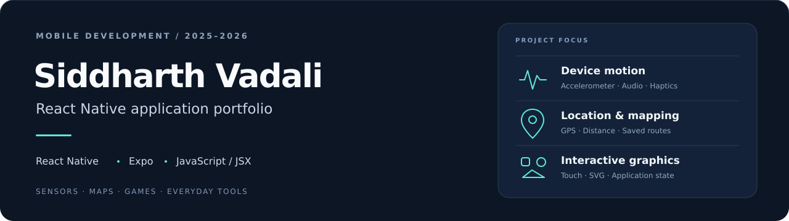

<p align="center">
  
</p>

# React Native application portfolio

A collection of mobile applications exploring phone sensors, location data, interactive graphics, games, and everyday utilities. Built with **React Native, Expo, and JavaScript/JSX** during **2025–2026**.

**11 apps** · **1 collaborative Clock variant** · **1 stock-dashboard prototype**

[Featured work](#featured-work) · [App directory](#app-directory) · [Run locally](#run-locally) · [Documentation](#documentation)

## Featured work

| Project | Experience | Engineering focus |
| --- | --- | --- |
| **[RouteMapper](apps/route-mapper/README.md)** | Record a route, inspect distance/pace/elevation, and reopen saved runs. | GPS updates, Haversine distance, maps, local persistence |
| **[TiltGame · Star Rush](apps/tilt-game/README.md)** | Steer with phone tilt, catch stars and hearts, and avoid bombs as the pace increases. | Accelerometer input, collision detection, game state, haptics |
| **[PainterStarter](apps/painter-starter/README.md)** | Draw, fill, select, move, erase, and undo SVG shapes and freehand strokes. | Touch gestures, geometry, SVG rendering, interaction state |

RouteMapper uses the complete collaborative saved implementation. Attribution and original project names are recorded in the project source notes.


## App directory

Each project includes its own source, assets, dependency lockfile, setup guide, and original Snack link.

| Project | Focus | Bundle targets |
| --- | --- | --- |
| [Which Am I](apps/which-am-i/README.md) | Weighted recommendations · Forms · Navigation | iOS · Android · Web |
| [Lightsaber](apps/lightsaber/README.md) | Motion sensors · Sound · Haptics | iOS · Android |
| [TiltGame (Star Rush)](apps/tilt-game/README.md) | Sensor input · Game state · Collision detection | iOS · Android |
| [PainterStarter](apps/painter-starter/README.md) | Touch input · SVG · Shape manipulation | iOS · Android · Web |
| [RouteMapper](apps/route-mapper/README.md) | GPS · Distance calculations · Persistence | iOS · Android |
| [GlobalGuesser](apps/global-guesser/README.md) | Map interaction · Distance-based scoring | iOS · Android |
| [MemoryApp](apps/memory-app/README.md) | Shuffled cards · Matching state · Saved scores | iOS · Android · Web |
| [Clock](apps/clock/README.md) | Timers · State transitions · Input validation | iOS · Android · Web |
| [Times Tables](apps/times-tables/README.md) | Question flows · Answer entry · Review | iOS · Android · Web |
| [Calculator](apps/calculator/README.md) | Expressions · Numeric operations · Error handling | iOS · Android · Web |
| [Weather App](apps/weather-app/README.md) | REST APIs · Forecast aggregation · Async state | iOS · Android · Web |


### Additional work

| Project | Status | Scope |
| --- | --- | --- |
| [Clock suite](apps/clock-suite/README.md) | Collaborative variant | Tabbed interval timer, countdown, and stopwatch; original attribution retained |
| [Stock Watcher](apps/stock-watcher/README.md) | Prototype | Configured quote/metric requests and a chart UI; simulated chart fallback and placeholder news/company sections |

The stock dashboard is separate from the **Python/PyTorch AI Stock Market Predictor** listed as in progress on the résumé.

## Run locally

Install **Node.js 22.13+**, clone this repository, and choose an app:

```bash
git clone https://github.com/SiddV19/expo-app-portfolio.git
cd expo-app-portfolio
npm run setup -- calculator
npm start -- calculator
```

Run <code>npm start</code> to list all project IDs. Add <code>--web</code> for a supported browser preview, such as <code>npm start -- calculator --web</code>.

For native features, use an Expo Go version or development build matching the app's SDK. **Lightsaber uses SDK 55; the other exports use SDK 54.** Projects install independently.

Weather App and the Stock Watcher prototype require the [local API proxy](services/api-proxy/README.md). Provider credentials stay on that server; the Expo apps receive its URL.

## Engineering notes

| Area | Examples |
| --- | --- |
| Device integration | Accelerometer input, orientation, audio, haptics, foreground GPS |
| Interaction and state | Quiz scoring, game loops, card matching, drawing tools, timers |
| Data and persistence | Saved routes/results, forecast aggregation, API loading/error states |
| Reproducibility | Independent project folders, lockfiles, run guides, original-source links |

### Validation

**35 JavaScript/asset exports passed across all 13 project folders:** 13 iOS, 13 Android, and 9 web. The API proxy also has tests for configuration, allowed endpoints, coordinate validation, and credential-safe error responses.

Exports verify bundling; physical sensor/GPS/audio behavior and live provider access have separate checklists. See the [validation record](verification/README.md) for exact scope.

```bash
npm run validate
npm test
npm run verify:exports -- calculator
```

## Documentation

| Guide | Purpose |
| --- | --- |
| [Project naming](docs/RESUME_MAPPING.md) | Consistent names across GitHub, LinkedIn, and the résumé |
| [LinkedIn / résumé copy](docs/PROFILE_TEXT.md) | Ready-to-use project descriptions and bullets |
| [Validation](verification/README.md) | Export records, preview checks, and remaining device checks |
| [Source inventory](docs/SNACK_INVENTORY.md) | Saved Snacks, selected implementations, drafts, and earlier versions |
| [Maintenance notes](docs/MAINTENANCE.md) | Packaging changes and source provenance |

---

**Siddharth Vadali** · [GitHub](https://github.com/SiddV19) · React Native / Expo · 2025–2026
