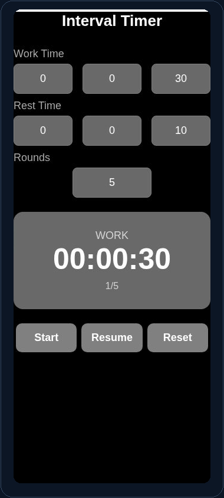

[← Portfolio](../../README.md) · [Original Snack](https://snack.expo.dev/@siddv19/clockvadali) · [Source notes](SOURCE.md)

# Clock

**Application · Expo SDK 54 · iOS / Android / Web**

Configurable work/rest interval timer with rounds, pause/resume, and reset.

## What it demonstrates

- Configurable work time, rest time, and rounds drive an interval timer.
- Start, pause/resume, and reset actions manage the timer's state transitions.
- Input validation, time formatting, and ticker cleanup support the interaction.

## Interface preview

<p align="center">

</p>

Interval timer paused during a work phase. Captured from the saved Expo Snack web preview.

## Run locally

From the repository root:

```bash
npm run setup -- clock
npm start -- clock
```

Use Node.js 22.13+ and an Expo runtime that supports SDK 54. You can also run <code>npm ci</code> and <code>npm start</code> directly in this project folder.

For a browser preview:

```bash
npm start -- clock --web
```

## Validation

| Target | Recorded result |
| --- | --- |
| iOS | JS / asset export passed |
| Android | JS / asset export passed |
| Web | JS / asset export passed |

An export verifies JavaScript and asset bundling. It is separate from a native binary build, a physical-device test, or a live-provider test. See the [validation record](../../verification/README.md) for scope and timestamps.

### Functional checklist

- Set work/rest periods to one second and rounds to one.
- Start; verify work, rest, and completion.
- Test pause/resume and reset during a longer interval.
