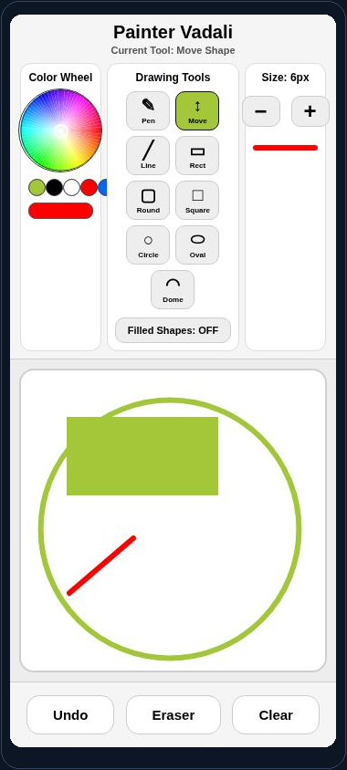

[← Portfolio](../../README.md) · [Original Snack](https://snack.expo.dev/@siddv19/painterstartervadali) · [Source notes](SOURCE.md)

# PainterStarter

**Application · Expo SDK 54 · iOS / Android / Web**

Touch drawing canvas with freehand paths, geometric shapes, fill, erasing, movement, and undo.

## What it demonstrates

- Freehand strokes and geometric tools render paths and shapes with SVG.
- Color, thickness, fill, erase, selection, and movement are controlled through application state.
- Undo and clear actions support an iterative drawing workflow.

## Interface preview

<p align="center">

</p>

SVG drawing demo with shape tools, fill, selection, and movement. Captured from the saved Expo Snack web preview.

## Run locally

From the repository root:

```bash
npm run setup -- painter-starter
npm start -- painter-starter
```

Use Node.js 22.13+ and an Expo runtime that supports SDK 54. You can also run <code>npm ci</code> and <code>npm start</code> directly in this project folder.

For a browser preview:

```bash
npm start -- painter-starter --web
```

## Validation

| Target | Recorded result |
| --- | --- |
| iOS | JS / asset export passed |
| Android | JS / asset export passed |
| Web | JS / asset export passed |

An export verifies JavaScript and asset bundling. It is separate from a native binary build, a physical-device test, or a live-provider test. See the [validation record](../../verification/README.md) for scope and timestamps.

### Functional checklist

- Draw a freehand path and a filled geometric shape.
- Move a selected shape, erase, undo, and clear.
- Change color and thickness and verify subsequent strokes.
