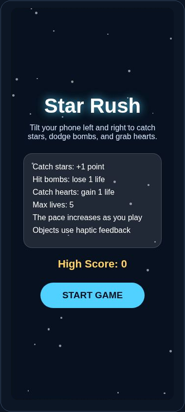

[← Portfolio](../../README.md) · [Original Snack](https://snack.expo.dev/@siddv19/tiltgamevadali) · [Source notes](SOURCE.md)

# TiltGame (Star Rush)

**Application · Expo SDK 54 · iOS / Android**

Tilt-controlled arcade game: catch stars, avoid bombs, and collect hearts as the pace increases.

## What it demonstrates

- Tilt input moves the player through a falling-object game loop.
- Stars, bombs, and hearts update points and lives through collision detection.
- Increasing pace, levels, haptics, and a session high score complete the game flow.

## Interface preview

<p align="center">

</p>

Star Rush start screen. Gameplay uses physical device motion. Captured from the saved Expo Snack web preview.

## Run locally

From the repository root:

```bash
npm run setup -- tilt-game
npm start -- tilt-game
```

Use Node.js 22.13+ and an Expo runtime that supports SDK 54. You can also run <code>npm ci</code> and <code>npm start</code> directly in this project folder.

This app uses native device capabilities. Run it on a matching iOS/Android runtime; physical motion, maps, audio, and haptics should be checked on a suitable device.

## Implementation note

The high score in this saved implementation lasts for the current app session.

## Validation

| Target | Recorded result |
| --- | --- |
| iOS | JS / asset export passed |
| Android | JS / asset export passed |

An export verifies JavaScript and asset bundling. It is separate from a native binary build, a physical-device test, or a live-provider test. See the [validation record](../../verification/README.md) for scope and timestamps.

### Functional checklist

- Start on a physical phone and tilt left/right.
- Catch a star, a heart, and a bomb; verify points and lives.
- Finish a game, replay, and verify the session high score.
